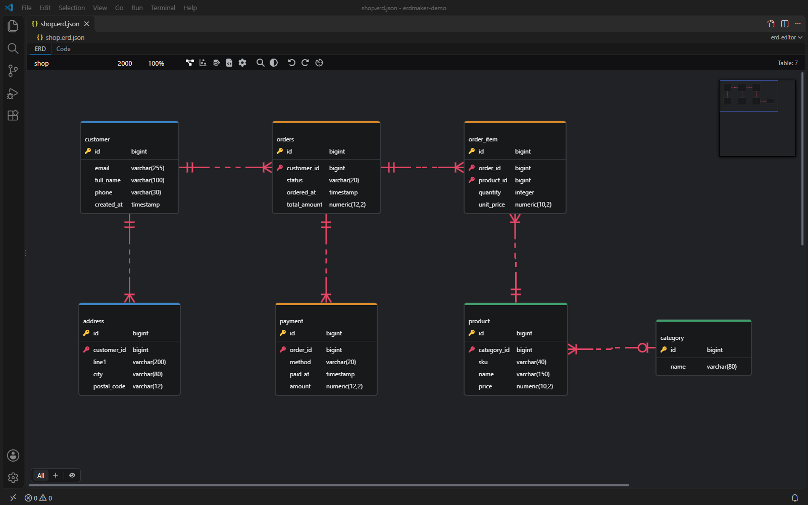
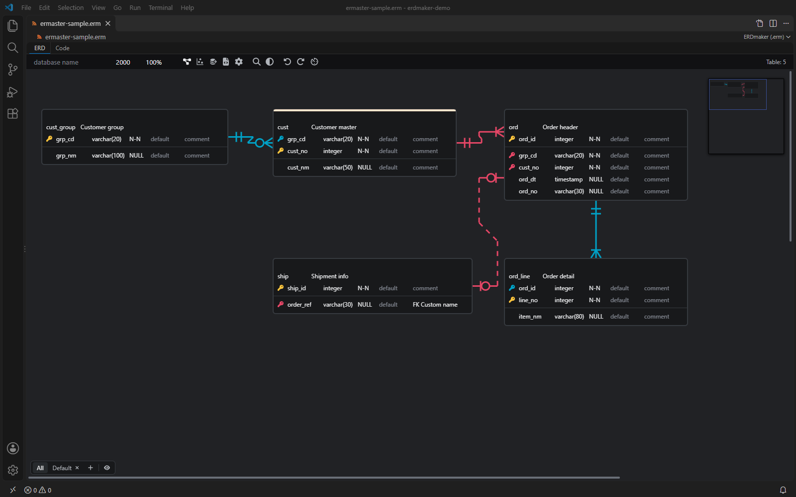
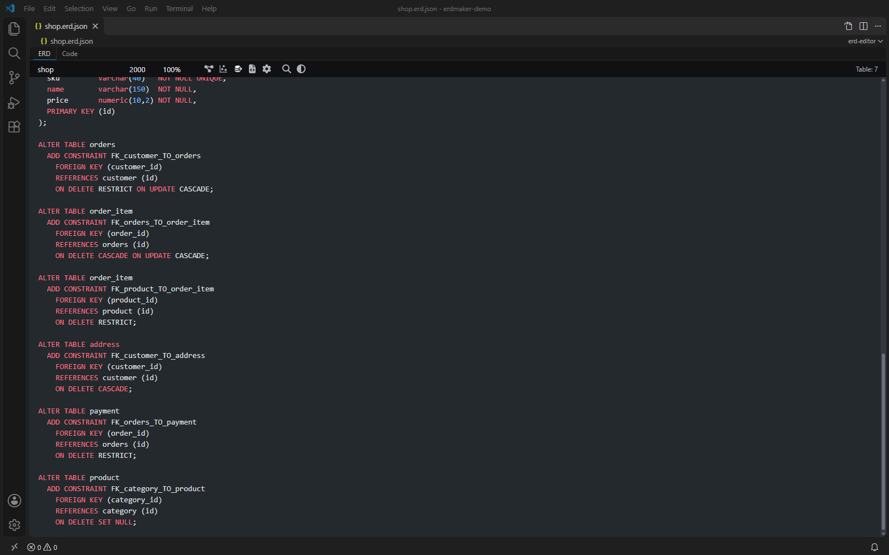
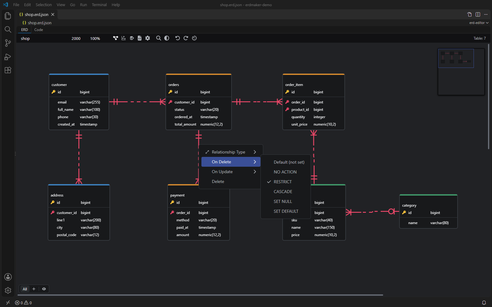

# ERDmaker

**An ERD editor for VS Code that opens and saves Eclipse ERMaster `.erm` files.**
Draw tables and relationships, export DDL for PostgreSQL, MySQL, MariaDB and Oracle, and compare your diagram with a live PostgreSQL database.

**English** | [한국어](#한국어)

## Install

- Open the **[Marketplace page](https://marketplace.visualstudio.com/items?itemName=genishs.erdmaker)** and select **Install**, or
- in VS Code press `Ctrl+P` (`Cmd+P` on macOS), paste `ext install genishs.erdmaker` and press Enter, or
- open the Extensions view, search for **ERDmaker**, and select **Install**.

ERDmaker needs VS Code 1.85 or later. Marketplace ID: `genishs.erdmaker`.

## What it does

- **ERMaster compatible.** Open, edit and save `.erm` files directly. ERMaster-only settings (sequences, triggers, tablespaces, column groups) are preserved, and the file still opens in Eclipse ERMaster.
- **DDL for four database vendors.** PostgreSQL, MySQL, MariaDB and Oracle (12c+ and 11g), with type mapping and warnings when a conversion is lossy.
- **Compare and apply.** Diff your ERD against a live PostgreSQL database, review the generated ALTER script, then apply it in a single transaction. Destructive statements are commented out by default.
- **Reverse-engineer** a PostgreSQL schema into an ERD; database comments become logical names.
- **Logical and physical names**, database views, and Excel / HTML table specifications. The editor is available in English and Korean.

ERDmaker is an independent project and is not affiliated with Eclipse ERMaster.
It is derived from [erd-editor](https://github.com/dineug/erd-editor) (MIT).

> **The source code of ERDmaker is not hosted in this repository.**
> This repository is the public **feedback and bug-report tracker** and its issue templates only.

## Quick start

1. Open the Command Palette (`Ctrl+Shift+P` / `Cmd+Shift+P`).
2. Run **ERDmaker: New Empty ERD…** to start a new `.erm` diagram, or open an existing `.erm` file by double-clicking it.
3. To start from a database, run **ERDmaker: Import ERD from PostgreSQL**.
4. New to ERDmaker? Run **ERDmaker: Start Tutorial**, or open **Help > Get Started** and choose **Get Started with ERDmaker**.

## How to send feedback

### If you have a GitHub account

Open an issue in this repository:

- **[Report a bug](https://github.com/genishs/erdmaker/issues/new?template=bug_report.yml)**
- **[Request a feature](https://github.com/genishs/erdmaker/issues/new?template=feature_request.yml)**

Please search the [existing issues](https://github.com/genishs/erdmaker/issues)
first, in case someone has already reported the same thing.

### If you do not have a GitHub account

Use the **Q&A** tab on the
[Marketplace page](https://marketplace.visualstudio.com/items?itemName=genishs.erdmaker&ssr=false#qna).

### From inside VS Code (version 0.5.1 or later)

Run the command **`ERDmaker: Report Issue / Send Feedback`** from the Command
Palette. It opens a pre-filled report form with diagnostic information already
filled in (extension version, VS Code version, OS, and so on). Review the text
before you submit it.

## What to include in a report

- **Extension version, including the build number** (required). Open the
  Extensions view in VS Code and select ERDmaker: the version is shown next to
  its name (for example `0.5.1`). **The last number is the build number**, so
  `0.5.1` means build 1 of the 0.5 line. If you open the report with the
  `ERDmaker: Report Issue / Send Feedback` command, this field is filled in
  for you automatically.
- **VS Code version** (`Help > About`)
- **Operating system**
- **Steps to reproduce** the problem, and what you expected to happen

Screenshots, log excerpts, and a small example that reproduces the problem are
very welcome.

## Privacy notice

**This is a public repository. Everyone on the internet can read what you post.**

Do **not** post:

- database connection details or passwords (host names, user names, connection strings, tokens, API keys)
- schemas, table or column names, or ERD contents that you are not allowed to make public

To reproduce a problem, please use a **reduced, anonymized example** (a few
generic tables such as `table_a`, `table_b` that still trigger the problem)
instead of your real schema.

---

## 한국어

**VS Code 에서 Eclipse ERMaster `.erm` 파일을 그대로 열고 저장하는 ERD 편집기**,
**[ERDmaker](https://marketplace.visualstudio.com/items?itemName=genishs.erdmaker)**
(마켓 ID: `genishs.erdmaker`)입니다.

### 설치

- **[마켓 페이지](https://marketplace.visualstudio.com/items?itemName=genishs.erdmaker)** 에서 **설치**를 누르거나,
- VS Code 에서 `Ctrl+P` 를 누르고 `ext install genishs.erdmaker` 를 붙여 넣은 뒤 Enter, 또는
- 확장 보기에서 **ERDmaker** 를 검색해 **설치**합니다.

VS Code 1.85 이상이 필요합니다.

### 할 수 있는 일

- **ERMaster 호환**: `.erm` 을 직접 열고 편집·저장합니다. ERMaster 전용 설정(시퀀스·트리거·테이블스페이스·컬럼 그룹)은 보존되어 Eclipse ERMaster 에서도 다시 열립니다.
- **DDL 내보내기**: PostgreSQL · MySQL · MariaDB · Oracle(12c 이상·11g). 타입 변환 경고를 DDL 머리에 적어 줍니다.
- **비교·반영**: ERD 와 실제 PostgreSQL 데이터베이스를 비교해 ALTER 스크립트를 만들고, 확인한 뒤 한 트랜잭션으로 반영합니다. 위험한 문장(삭제 등)은 기본으로 주석 처리됩니다.
- **가져오기**: PostgreSQL 스키마를 ERD 로 가져오며, DB 코멘트는 논리명이 됩니다.
- **논리명·물리명**, 뷰, Excel/HTML 테이블 정의서. 편집기는 영어와 한국어를 지원합니다.

DB 직접 연결(가져오기·비교·반영)은 현재 **PostgreSQL 만** 지원합니다.
ERDmaker 는 독립 프로젝트이며 Eclipse ERMaster 와 제휴 관계가 아닙니다.

> **ERDmaker의 소스 코드는 이 레포에 없습니다.**
> 이 레포에는 이슈 트래커와 신고 양식만 있습니다.

### 피드백 남기는 방법

**GitHub 계정이 있으면** 이 레포의 Issues로 버그 신고·기능 요청을 남길 수 있습니다.

- **[버그 신고](https://github.com/genishs/erdmaker/issues/new?template=bug_report.yml)**
- **[기능 요청](https://github.com/genishs/erdmaker/issues/new?template=feature_request.yml)**

같은 내용이 이미 올라와 있을 수 있으니 [기존 이슈](https://github.com/genishs/erdmaker/issues)를
먼저 검색해 주세요.

**GitHub 계정이 없다면** 마켓 페이지의
[Q&A 탭](https://marketplace.visualstudio.com/items?itemName=genishs.erdmaker&ssr=false#qna)을
이용해 주세요.

**확장 안에서 바로 신고하기 (0.5.1 버전부터)**: 명령 팔레트에서
**`ERDmaker: Report Issue / Send Feedback`** 명령을 실행하면 진단 정보(확장 버전,
VS Code 버전, OS 등)가 미리 채워진 신고 화면이 열립니다. 제출하기 전에 내용을 한 번 확인해 주세요.

### 신고에 넣어 주실 것

- **확장 버전(빌드번호 포함, 필수)**: VS Code의 확장 보기에서 ERDmaker를 선택하면 이름 옆에
  버전(예: `0.5.1`)이 보입니다. **마지막 숫자가 빌드번호**입니다. 즉 `0.5.1`은 0.5 라인의
  빌드 1입니다. `ERDmaker: Report Issue / Send Feedback` 명령으로 신고 화면을 열면 이 칸은
  자동으로 채워집니다.
- **VS Code 버전** (`도움말 > 정보`)
- **운영체제**
- **재현 절차**와 기대했던 결과

스크린샷, 로그 일부, 문제를 재현하는 작은 예제가 있으면 큰 도움이 됩니다.

### 개인정보 주의

**이 레포는 공개 레포입니다. 올린 내용은 누구나 볼 수 있습니다.**

다음은 **올리지 마세요**.

- DB 접속 정보와 비밀번호 (호스트 이름, 사용자 이름, 접속 문자열, 토큰, API 키 등)
- 공개하면 안 되는 스키마, 테이블·컬럼 이름, ERD 내용

문제를 재현할 때는 실제 스키마 대신 **축소하고 익명화한 예제**(문제가 그대로 재현되는
`table_a`, `table_b` 같은 몇 개의 일반적인 테이블)를 사용해 주세요.
